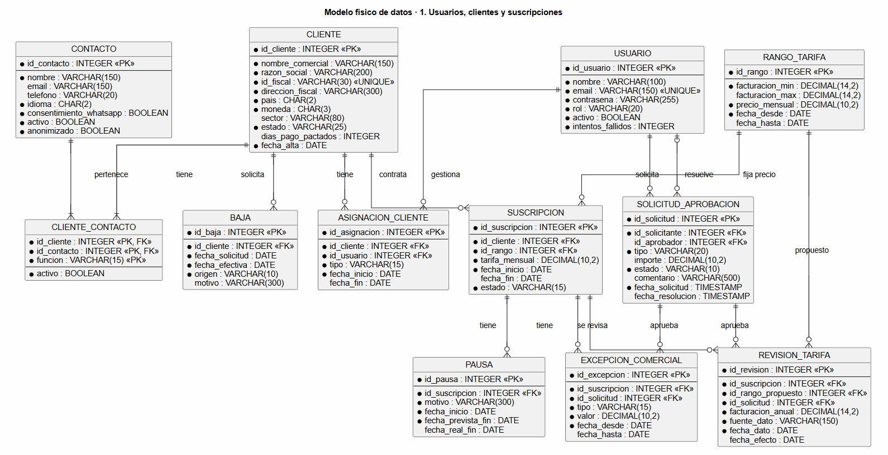
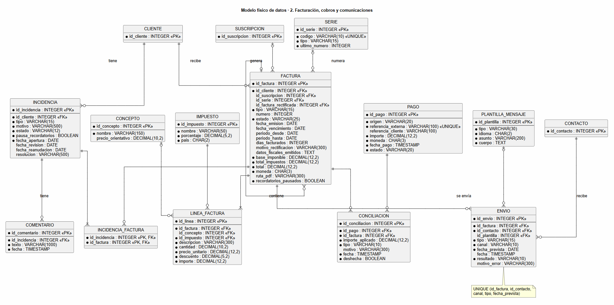
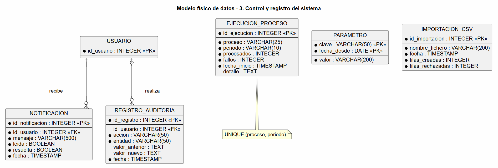
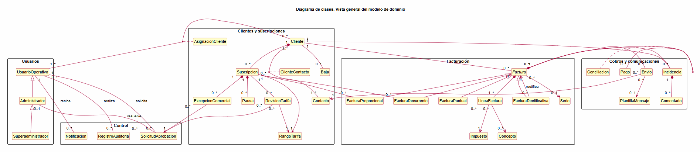
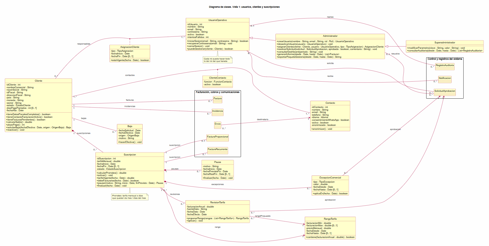
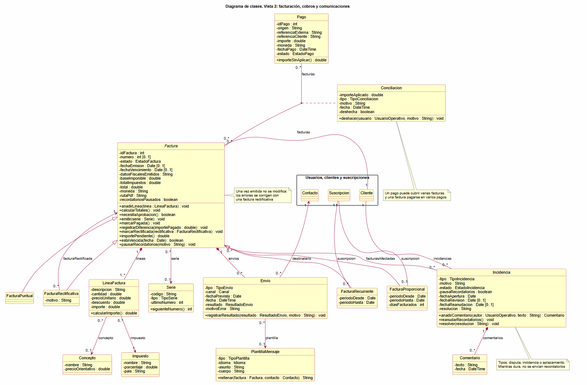
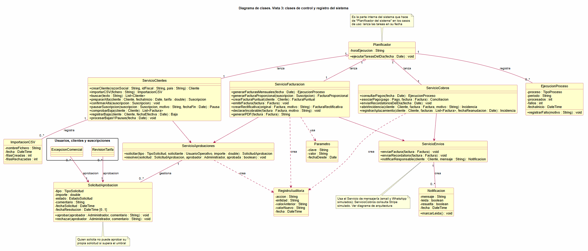
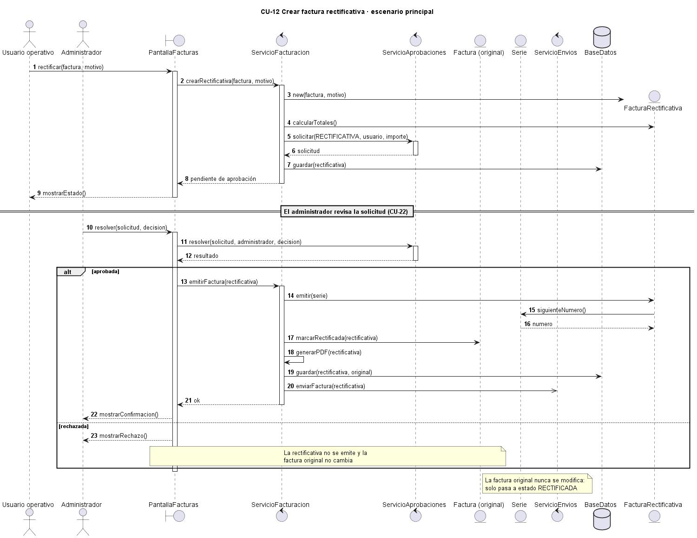
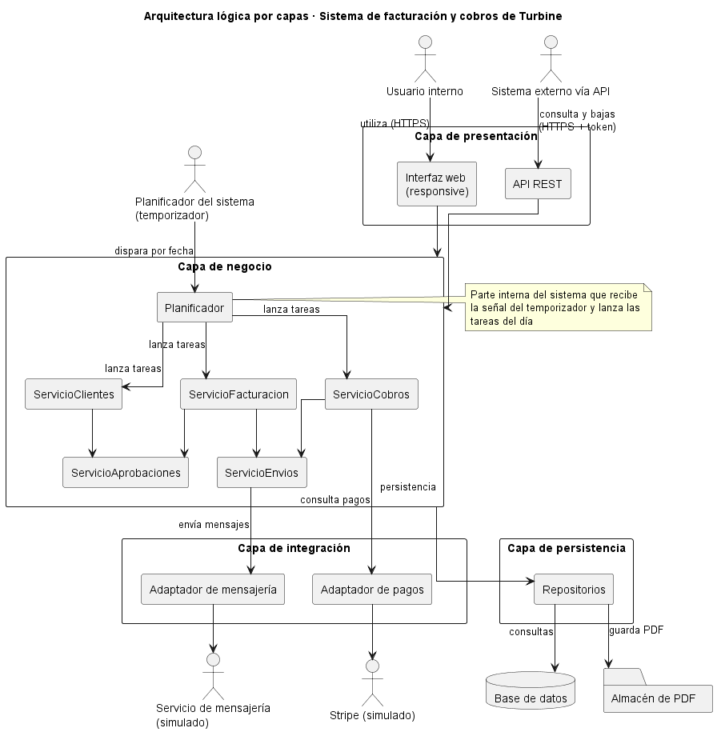

# Entrega 2 · Diseño del sistema

**Asignatura:** Análisis y Diseño de Aplicaciones · Grupo A · 2026–27  
**Equipo:** [Sapitos]  
**Integrantes:** [Francisco Jiménez Tirado][ Emilio José Aragón Ortegosa] [Marco Gallego Zafra][Ismael García Zamudio][Miguel Vargas Peña][Francisco Sánchez Gámez][Iván González Doña]
**Fecha:** [27/11/2026]  
**Repositorio:** [https://github.com/FrankiPato/ADA-sapitos.git]

## 1. Introducción y alcance

Este informe presenta el diseño del sistema de facturación y cobros de Turbine, una aplicación web de uso interno con la que el personal administrativo podrá registrar clientes, generar facturas puntuales y recurrentes, enviarlas automáticamente y hacer el seguimiento de los cobros.

El diseño parte de la Entrega 1 actualizada: los requisitos (83 requisitos funcionales, 30 no funcionales y 23 reglas de negocio) y los 27 casos de uso, repartidos en cinco bloques (acceso y administración, clientes y suscripciones, facturación y envíos, cobros y aprobaciones, y consulta e integración externa). Antes de diseñar hemos corregido la Entrega 1 con las observaciones del profesor y del cliente; los cambios se recogen en el capítulo 2.

El informe incluye:

- El modelo físico de datos, con las tablas, claves y relaciones de la base de datos (capítulo 3).
- El diagrama de clases, dividido en una vista general y tres vistas de detalle (capítulo 4).
- Cuatro diagramas de secuencia de los escenarios más relevantes: alta con prorrateo (CU-06), factura rectificativa (CU-12), conciliación de pagos (CU-13) y baja de un cliente con deuda (CU-17) (capítulo 5).
- La arquitectura lógica del sistema, organizada en capas (capítulo 6).
- El informe Scrum de esta entrega (capítulo 7).

Queda fuera de esta entrega la implementación, que corresponde a la Entrega 3. Stripe y el servicio de email y WhatsApp se tratan como sistemas externos simulados, tal como autorizó el cliente. Los fuentes de todos los diagramas (PlantUML) y sus explicaciones están en la carpeta `entrega2/` del repositorio.

## 2. Actualizaciones de la Entrega 1

Los cambios salen de dos revisiones: el **informe de evaluación del profesor** de la Entrega 1 y el **informe de Alejandro Ruiz** (cliente) tras la presentación del 09/11. Las fuentes actualizadas están en `entrega1-actualizada/fuentes/`.

### Cambios ya hechos

| Elemento | Cambio | Motivo | Impacto en Entrega 2 | Validación / pendiente |
|---|---|---|---|---|
| Requisitos, apartado 8.3 (nuevo) | Tabla de trazabilidad de cada regla de negocio con sus requisitos funcionales y casos de uso | Informe del profesor: las reglas (prorrateo, cobros, alta) solo aparecían dentro de los flujos | Las decisiones de clases, ER y secuencias se pueden justificar con su regla (por ejemplo, RB-05 en `Suscripcion.calcularProrrateo` y en la secuencia CU-06) | Hecho |
| Requisitos, apartado 8.4 (nuevo) | Tabla de trazabilidad de cada requisito funcional con su caso de uso | Informe del profesor: faltaba enlazar FR con CU | Base para la trazabilidad de los `.md` de documentación | Hecho. Ningún FR queda sin caso de uso |
| Requisitos, apartado 8.5 | El antiguo 8.3 (ejemplo de la baja con deuda) pasa a ser el 8.5 y se actualiza su frase final | Reorganización por las tablas nuevas | Ninguno | Hecho |
| Requisitos, apartado 1.4 (nuevo) | Tabla de procesos automáticos: quién los inicia, qué hace el sistema solo y cuándo interviene una persona | Informe del profesor: revisar los límites de la automatización | Define las tareas del `Planificador` en clases, secuencias (CU-13, CU-17) y arquitectura | Hecho |
| Requisitos 1.3, A-18 y glosario | El "Planificador del sistema" se define como temporizador (el paso del tiempo), no como componente | Informe del profesor: separar actor externo, temporizador y componente interno | El temporizador es un actor; dentro del sistema lo recibe el componente `Planificador` (clases y arquitectura) | Hecho |
| Requisitos 1.2 | Se quita el texto de la plantilla que se había quedado | Corrección | Ninguno | Hecho |
| UR-19 y A-21 | UR-19 (sustituciones temporales) se añade a las tablas 8.1 y 8.2, y se quita la "delegación temporal" de A-21 | Había una contradicción: A-21 la aplazaba, pero UR-19 y FR-07 la incluían | `AsignacionCliente` con tipo HABITUAL o SUSTITUCION y fechas (clases y ER) | Hecho |
| FR-83 (nuevo) | Pausar los recordatorios cuando el cliente llama para negociar un aplazamiento, con fecha de reanudación | Informe del cliente: pidió poder pausar los avisos tras una llamada comercial | `Incidencia` de tipo APLAZAMIENTO con `fechaReanudacion`; `ServicioCobros.registrarAplazamiento` (clases y ER) | Hecho |
| RB-14 | Se deja claro que la baja no cancela ni condona las deudas | Informe del cliente: pidió que la regla lo dijera de forma explícita | Secuencia CU-17 (baja con facturas pendientes) | Hecho |
| RB-22 (nueva) | Mientras los recordatorios están pausados, la factura sigue pendiente y su vencimiento no cambia | Informe del cliente: pregunta sobre cómo se reflejan las pausas en CU-11 | `Factura.recordatoriosPausados` (clases y ER) | Hecho |
| RB-23 (nueva) | El sistema no envía dos veces el mismo mensaje aunque el proceso se repita | Informe del cliente: pregunta sobre cómo se evitan las notificaciones duplicadas | Restricción UNIQUE en la tabla ENVIO y atributo `Envio.fechaPrevista` | Hecho |
| CU-15 | Nuevo flujo alternativo FA-3 "Aplazamiento negociado por teléfono" | Recoger FR-83 en los casos de uso | Operación `registrarAplazamiento` | Hecho |
| CU-11 | FA-2 incluye también los aplazamientos y la pausa dura "hasta que termine la pausa" | Coherencia con FR-83 y RB-22 | Ninguno | Hecho |
| CU-10, CU-11, CU-15 | Se añaden FR-83, RB-22 y RB-23 a sus requisitos relacionados | Coherencia con la trazabilidad | Ninguno | Hecho |
| Trazabilidad 8.1 a 8.4 | Se añaden FR-83, RB-22 y RB-23 | Mantener la trazabilidad completa | Ninguno | Hecho |
| Repositorio | Las fuentes de la Entrega 1 pasan de `doc/src/` a `entrega1-actualizada/fuentes/` | Nueva estructura de carpetas del profesor | Ninguno | Hecho |

### Respuestas a las preguntas del cliente

| Pregunta | Dónde se responde |
|---|---|
| ¿Cómo se reflejan las pausas de los avisos en el CU-11? | CU-11 (FA-2), CU-15 (FA-3) y RB-22 |
| ¿Cuál es la secuencia exacta para generar una factura rectificativa? | Diagrama de secuencia `CU-12.puml` de esta entrega |
| ¿Cómo se evitan las notificaciones duplicadas? | RB-23 y la restricción UNIQUE de la tabla ENVIO |

### Pendiente de confirmar con el cliente

Estas decisiones se mantienen como provisionales. No cambian el diseño, pero conviene confirmarlas:

| Elemento | Hipótesis actual | Pendiente |
|---|---|---|
| Q-01 | Un cliente con deuda puede darse de baja, pero se le sigue reclamando lo pendiente | Confirmar con el cliente (ya lo confirmó de forma implícita en su informe) |
| Q-17 | El plazo de pago de 5 días se cuenta en días naturales | Confirmar con el cliente |
| Q-10 | Los rangos de tarifa son configurables | Pedir la tabla de tarifas actual |
| Q-11, Q-13 | Tiempo de conservación de datos y datos fiscales obligatorios de clientes extranjeros | Confirmar con la gestoría |
| Q-12 | Campos del PDF de la factura | Recibir la factura de ejemplo |
| Q-14 | Umbrales de aprobación: 2.000 € y 10.000 € | Confirmar los importes |
## 3. Modelo físico de datos (Entidad–Relación)

## Alcance
 
Este modelo describe las tablas de la base de datos del sistema de facturación y cobros de Turbine. Se deriva de las clases de dominio y de registro del diagrama de clases: cada una de ellas se convierte en una tabla, y las relaciones muchos a muchos se resuelven mediante tablas intermedias. Las clases de control (`Planificador` y los servicios) no almacenan información, por lo que no tienen tabla propia.
 
El resultado son 29 tablas. Para facilitar su lectura, se han repartido en tres diagramas (`diagramas/Modelo_datos_ER/modelo_datos.puml`). Si una tabla aparece en un diagrama únicamente con su clave primaria, es porque su definición completa está en otro.
 
| Diagrama | Tablas |
|---|---|
| 1. Usuarios, clientes y suscripciones | USUARIO, CLIENTE, ASIGNACION_CLIENTE, CONTACTO, CLIENTE_CONTACTO, RANGO_TARIFA, SUSCRIPCION, PAUSA, BAJA, SOLICITUD_APROBACION, REVISION_TARIFA, EXCEPCION_COMERCIAL |
| 2. Facturación, cobros y comunicaciones | FACTURA, LINEA_FACTURA, SERIE, CONCEPTO, IMPUESTO, PAGO, CONCILIACION, PLANTILLA_MENSAJE, ENVIO, INCIDENCIA, INCIDENCIA_FACTURA, COMENTARIO |
| 3. Control y registro del sistema | NOTIFICACION, REGISTRO_AUDITORIA, EJECUCION_PROCESO, PARAMETRO, IMPORTACION_CSV |
 
En los diagramas, el símbolo `*` marca las columnas obligatorias (NOT NULL).

### Parte 1: Usuarios, clientes y suscripciones
 

### Parte 2: Facturación, cobros y comunicaciones

### Parte 3: Control y registro del sistema

 
## Justificación del modelo
 
- **Jerarquías en una única tabla.** Los tres roles de usuario conviven en `USUARIO`, diferenciados por la columna `rol`, y los cuatro tipos de factura conviven en `FACTURA`, diferenciados por la columna `tipo`. Las columnas que solo aplican a ciertos tipos (periodo, días facturados, factura rectificada, motivo de la rectificación) admiten valores vacíos. Se ha elegido esta opción frente a una tabla por tipo porque la gran mayoría de columnas son comunes y las consultas sobre facturas resultan más simples.
- **Tablas intermedias.** `ASIGNACION_CLIENTE` (usuario–cliente, con fechas para registrar sustituciones), `CLIENTE_CONTACTO` (cliente–contacto, con la función del contacto), `CONCILIACION` (pago–factura, con el importe aplicado) e `INCIDENCIA_FACTURA` (una incidencia o aplazamiento puede afectar a varias facturas).
- **Relaciones principales:**
  - `CLIENTE (1)` — `SUSCRIPCION (0..N)`: un cliente puede acumular varias suscripciones a lo largo del tiempo, por ejemplo si causa baja y luego se reactiva.
  - `CLIENTE (1)` — `FACTURA (0..N)` y `SUSCRIPCION (0..1)` — `FACTURA (0..N)`: las facturas puntuales no están asociadas a ninguna suscripción.
  - `FACTURA (1)` — `LINEA_FACTURA (1..N)`: toda factura contiene como mínimo una línea.
  - `FACTURA (0..1)` — `FACTURA (0..N)`: una factura rectificativa referencia a la factura que corrige.
  - `PAGO` y `FACTURA` mantienen una relación muchos a muchos a través de `CONCILIACION`.
  - `USUARIO (1)` — `SOLICITUD_APROBACION (0..N)` en el papel de solicitante, y `USUARIO (0..1)` en el de aprobador, ya que mientras la solicitud está pendiente aún no existe aprobador.
- **Copia de los datos fiscales.** `FACTURA.datos_fiscales_emitidos` conserva los datos del cliente tal y como estaban al emitir la factura, de forma que esta no varíe aunque el cliente se modifique después (RB-10, FR-32).
- **Sin borrado físico.** Los clientes, contactos y usuarios no se eliminan: se desactivan o anonimizan mediante las columnas `estado`, `activo` y `anonimizado` (RB-19, FR-12).
## Reglas y restricciones
 
La notación de los diagramas no permite reflejar todas las restricciones, por lo que se recogen a continuación:
 
| Restricción | Regla |
|---|---|
| `USUARIO.email` y `CLIENTE.id_fiscal` con valores únicos | FR-11 |
| `UNIQUE (FACTURA.id_serie, FACTURA.numero)`: el número no se repite dentro de una misma serie | RB-11 |
| `UNIQUE (FACTURA.id_suscripcion, FACTURA.periodo_desde)`: como máximo una factura recurrente por suscripción y mes | NFR-11 |
| `PAGO.referencia_externa` única: un pago de Stripe no puede registrarse dos veces | FR-44 |
| `UNIQUE (ENVIO.id_factura, id_contacto, canal, tipo, fecha_prevista)`: el mismo mensaje no se envía dos veces | RB-23 |
| `UNIQUE (EJECUCION_PROCESO.proceso, periodo)`: un proceso automático no se ejecuta dos veces para el mismo periodo | NFR-11 |
| `FACTURA.estado` limitado a los estados de RB-09, y `CLIENTE.estado` a los de RB-20 | RB-09, RB-20 |
| `FACTURA.tipo` ∈ {PUNTUAL, RECURRENTE, PROPORCIONAL, RECTIFICATIVA}; `USUARIO.rol` ∈ {OPERATIVO, ADMINISTRADOR, SUPERADMINISTRADOR} | RB-18 |
| `INCIDENCIA.tipo` ∈ {DISPUTA, INCIDENCIA, APLAZAMIENTO}; cuando es APLAZAMIENTO, `fecha_reanudacion` es obligatoria | FR-83, RB-22 |
| `LINEA_FACTURA.cantidad > 0` y `descuento` comprendido entre 0 y 100 | FR-21 |
| Importes en `DECIMAL` con 2 decimales, sin utilizar tipos de coma flotante | RB-16, NFR-14 |
| `SOLICITUD_APROBACION.id_aprobador` distinto de `id_solicitante` cuando el importe supera el umbral (se valida en la aplicación) | FR-61 |
| `REGISTRO_AUDITORIA` solo admite inserciones: sus filas no se modifican ni se eliminan | NFR-21 |
| Una factura emitida es inmutable; únicamente pueden cambiar su `estado` y `recordatorios_pausados` | RB-10 |
 
## Trazabilidad
 
| Requisitos/casos | Tablas/columnas | Observación |
|---|---|---|
| FR-01 a FR-08, RB-18 · CU-01, CU-02, CU-03 | USUARIO, ASIGNACION_CLIENTE | Usuarios, roles y clientes asignados (incluidas las sustituciones, UR-19) |
| FR-09 a FR-15, FR-82, RB-01, RB-19, RB-20 · CU-04, CU-24 | CLIENTE, CONTACTO, CLIENTE_CONTACTO | Información de los clientes y de sus contactos |
| FR-71, FR-72 · CU-05 | IMPORTACION_CSV | Resumen de cada importación |
| FR-16 a FR-20, FR-52 a FR-56, RB-05, RB-14, RB-15 · CU-06, CU-17, CU-18 | SUSCRIPCION, PAUSA, BAJA | Alta con prorrateo, pausas y bajas |
| FR-57, FR-58, FR-81, RB-02, RB-03 · CU-20 | RANGO_TARIFA, REVISION_TARIFA, EXCEPCION_COMERCIAL | Tarifas, revisión anual y excepciones comerciales |
| FR-21 a FR-33, FR-80, RB-04, RB-09 a RB-11, RB-16 · CU-07, CU-08, CU-09, CU-12 | FACTURA, LINEA_FACTURA, SERIE, CONCEPTO, IMPUESTO | Facturas de todos los tipos, con sus líneas y su numeración |
| FR-42 a FR-48, RB-12 · CU-13, CU-14 | PAGO, CONCILIACION | Pagos recibidos y su vinculación con las facturas |
| FR-35 a FR-41, RB-07, RB-23 · CU-10, CU-11 | ENVIO, PLANTILLA_MENSAJE | Registro de cada envío y de su resultado |
| FR-49, FR-50, FR-83, RB-22 · CU-15 | INCIDENCIA, INCIDENCIA_FACTURA, COMENTARIO, FACTURA.recordatorios_pausados | Disputas, incidencias y aplazamientos |
| FR-51, FR-59 a FR-61, RB-13 · CU-16, CU-21, CU-22 | SOLICITUD_APROBACION | Solicitudes y su resolución |
| FR-62, FR-63 · CU-23 | NOTIFICACION | Avisos internos |
| FR-73 a FR-75, RB-17, NFR-21 · CU-26, CU-27 | PARAMETRO, REGISTRO_AUDITORIA, EJECUCION_PROCESO | Configuración, auditoría y seguimiento de los procesos |
 
## Decisiones abiertas
 
- **Plazo de conservación de los datos** (Q-11): debe confirmarlo la gestoría. Se almacenará como un registro de `PARAMETRO`.
- **Datos fiscales exigidos a clientes de otros países** (Q-13): por ahora solo son obligatorias las columnas de razón social, identificador fiscal y dirección. Si la gestoría solicita más información, se añadirán nuevas columnas a `CLIENTE`.
- **Tabla de rangos de tarifa** (Q-10): las filas de `RANGO_TARIFA` se cargarán cuando Turbine facilite su tabla vigente.
- **Alternativa descartada:** una tabla independiente para cada tipo de factura. Se rechazó porque casi todas las columnas eran comunes y habría complicado tanto las consultas como los informes.

## 4. Diagrama UML de clases
 
## Alcance
 
Este diagrama recoge la estructura estática del sistema de facturación y cobros de Turbine: por un lado, las clases del dominio (clientes, suscripciones, facturas, pagos, etc.) y, por otro, las clases de control, que concentran la aplicación de las reglas de negocio. Los sistemas externos (Stripe y el servicio de mensajería, ambos simulados) no se modelan como clases; se representan en el diagrama de arquitectura.
 
En total hay 40 clases: 29 de dominio, 5 de registro del sistema y 6 de control. Al no caber con claridad en una sola página, el modelo se ha repartido en una vista general y tres vistas asignadas para uno o más bloques (`diagramas/Clases/diagrama_clases.puml`):
 
| Vista | Contenido |
|---|---|
| Vista general | Solo se ven las relaciones entre clases sin entrar en mucho detalle |
| Vista 1 | Usuarios, clientes, contactos, suscripciones, pausas, bajas y tarifas |
| Vista 2 | Facturas, líneas, series, impuestos, pagos, conciliaciones, envíos e incidencias |
| Vista 3 | Clases de control (planificador y servicios) y registro del sistema (notificaciones, auditoría, procesos, parámetros e importaciones) |
 
Si una clase se ve sin atributos en una vista, es porque su detalle está en otra: se dibuja dentro de su paquete únicamente para poder mostrar la relación.

### Vista general
 

 
### Vista 1: usuarios, clientes y suscripciones
 

 
### Vista 2: facturación, cobros y comunicaciones
 

 
### Vista 3: clases de control y registro del sistema
 

 
## Decisiones de diseño
 
- **Jerarquía de roles.** `Administrador` extiende a `UsuarioOperativo` y `Superadministrador` extiende a `Administrador`. Reproduce la generalización de los diagramas de casos de uso: cada rol puede realizar todo lo que hace el rol del que hereda (RB-18, A-01).
- **`Factura` es una clase abstracta** con cuatro especializaciones: puntual, recurrente, proporcional y rectificativa. Las cuatro comparten la mayor parte de sus características, pero cada una añade datos propios (periodo, días facturados, factura rectificada).
- **Copia de los datos fiscales en la factura.** Al emitirla, la factura almacena los datos fiscales del cliente, ya que una factura emitida debe permanecer inalterable aunque luego se modifiquen los datos del cliente o la plantilla (RB-10, FR-32).
- **Composiciones.** `Factura`–`LineaFactura`, `Factura`–`Envio`, `Cliente`–`Suscripcion`, `Suscripcion`–`Pausa`, `Suscripcion`–`ExcepcionComercial` e `Incidencia`–`Comentario`: en todos los casos, las partes carecen de sentido sin el conjunto al que pertenecen.
- **Clases asociación.** `AsignacionCliente` (fechas de una asignación o sustitución, FR-07 y UR-19), `ClienteContacto` (función que desempeña un contacto en cada empresa, FR-82) y `Conciliacion` (importe de un pago aplicado a una factura, FR-43 y FR-47).
- **Relación muchos a muchos entre `Pago` y `Factura`**, resuelta mediante `Conciliacion`: un mismo pago puede saldar varias facturas y una factura puede abonarse con varios pagos. La factura solo pasa a pagada cuando el total queda cubierto (RB-12).
- **Seis clases de control** reparten las reglas de negocio por áreas: `ServicioClientes` (clientes, suscripciones, pausas y bajas), `ServicioFacturacion`, `ServicioCobros` (pagos, recordatorios e incidencias), `ServicioAprobaciones`, `ServicioEnvios` y `Planificador`. Se ha optado por pocas clases con responsabilidades bien definidas, en lugar de una clase por cada caso de uso.
- **`Planificador`** es el componente interno que materializa al actor "Planificador del sistema" de los casos de uso: a diario dispara las tareas de facturación, cobros, bajas y pausas. Se vincula con los servicios mediante agregación (A-18).
- **Los sistemas externos no son clases.** Stripe y la mensajería se utilizan desde `ServicioCobros` y `ServicioEnvios` y se reflejan en el diagrama de arquitectura (A-08, NFR-24).
- **`EjecucionProceso` con combinación única de proceso y periodo**, de modo que, si el proceso del día 1 se lanza dos veces, no se generen facturas duplicadas (NFR-11).
- **`Envio` con combinación única de factura, tipo y fecha prevista**, para evitar que un mismo mensaje se envíe dos veces aunque el Servicio de mensajería tarde en responder (RB-23).
- **Aplazamientos acordados.** Se modelan como una `Incidencia` de tipo `APLAZAMIENTO` con `fechaReanudacion`, que detiene los recordatorios de las facturas afectadas hasta esa fecha (FR-83, RB-22).
- **Las operaciones** expresan las responsabilidades de cada clase; no son las firmas definitivas de la implementación.
### Enumeraciones
 
Para no recargar el diagrama, las enumeraciones figuran como tipo de los atributos y sus valores se listan a continuación:
 
| Enumeración | Valores |
|---|---|
| Rol | OPERATIVO, ADMINISTRADOR, SUPERADMINISTRADOR |
| EstadoCliente | PENDIENTE_ACTIVACION, ACTIVO, PAUSADO, BAJA_SOLICITADA, INACTIVO (RB-20) |
| EstadoSuscripcion | PENDIENTE, ACTIVA, PAUSADA, FINALIZADA |
| EstadoFactura | BORRADOR, PENDIENTE_APROBACION, EMITIDA, ENVIADA, ENVIO_FALLIDO, VENCIDA, PAGADA, EN_DISPUTA, DIFERENCIA_IMPORTE, RECTIFICADA, ANULADA, INCOBRABLE (RB-09) |
| EstadoPago | ASOCIADO, PENDIENTE_ASOCIAR, CON_DIFERENCIA |
| TipoIncidencia | DISPUTA, INCIDENCIA, APLAZAMIENTO |
| TipoSolicitud | DESCUENTO, IMPORTE_ALTO, CAMBIO_IMPORTE, RECTIFICATIVA, INCOBRABLE, CAMBIO_TARIFA, EXCEPCION |
| TipoProceso | FACTURACION_MENSUAL, RECORDATORIOS, CONCILIACION, BAJAS_Y_PAUSAS, COPIA_SEGURIDAD |
| Otras | TipoAsignacion, FuncionContacto, Idioma, OrigenBaja, TipoExcepcion, TipoSerie, TipoConciliacion, EstadoIncidencia, TipoEnvio, Canal, ResultadoEnvio, TipoPlantilla, EstadoSolicitud, TipoNotificacion |
 
## Trazabilidad
 
| Requisito / CU | Clases y operaciones | Motivo |
|---|---|---|
| FR-01 a FR-08, RB-18 · CU-01, CU-02, CU-03 | `UsuarioOperativo.iniciarSesion`, `recuperarContrasena`, `Administrador`, `Superadministrador`, `AsignacionCliente` | Acceso, roles y permisos según el cliente asignado |
| FR-09 a FR-15, FR-71, FR-72, FR-82, RB-01, RB-19, RB-20 · CU-04, CU-05, CU-24 | `Cliente`, `Contacto`, `ClienteContacto`, `ServicioClientes.importarCSV`, `ImportacionCSV` | Gestión de clientes y contactos, e importación masiva |
| FR-16 a FR-20, FR-52 a FR-56, RB-05, RB-14, RB-15 · CU-06, CU-17, CU-18 | `Suscripcion.calcularProrrateo`, `Pausa`, `Baja`, `ServicioClientes` | Alta con prorrateo, pausas y bajas |
| FR-57, FR-58, FR-81, RB-02, RB-03 · CU-20 | `RangoTarifa`, `RevisionTarifa`, `ExcepcionComercial` | Tarifas y revisión anual |
| FR-21 a FR-34, FR-80, RB-04, RB-09 a RB-11, RB-16 · CU-07, CU-08, CU-09, CU-12 | `Factura` y subclases, `LineaFactura`, `Serie`, `Impuesto`, `ServicioFacturacion` | Facturas puntuales, recurrentes, proporcionales y rectificativas |
| FR-42 a FR-48, RB-12 · CU-13, CU-14 | `Pago`, `Conciliacion`, `ServicioCobros.consultarPagos`, `asociarPago` | Consulta de pagos y conciliación |
| FR-35 a FR-41, RB-07, RB-08, RB-23 · CU-10, CU-11 | `Envio`, `PlantillaMensaje`, `ServicioEnvios`, `ServicioCobros.enviarRecordatoriosDelDia` | Envío de facturas y recordatorios sin duplicados |
| FR-49, FR-50, FR-83, RB-22 · CU-15 | `Incidencia`, `Comentario`, `ServicioCobros.registrarAplazamiento` | Disputas, incidencias y aplazamientos |
| FR-51, FR-58 a FR-61, RB-13 · CU-16, CU-21, CU-22 | `SolicitudAprobacion`, `ServicioAprobaciones` | Aprobaciones con separación de funciones |
| FR-62 a FR-68 · CU-23, CU-25 | `Notificacion`, `ServicioEnvios.notificarResponsable`, `Administrador.consultarDashboard`, `generarInforme` | Avisos, panel de control e informes |
| FR-73 a FR-75, RB-17, NFR-21 · CU-26, CU-27 | `Parametro`, `Superadministrador.modificarParametro`, `RegistroAuditoria`, `EjecucionProceso` | Configuración, auditoría y seguimiento de procesos |
| FR-23, FR-39, FR-42, A-18 · CU-09, CU-11, CU-13 | `Planificador`, `EjecucionProceso` | Procesos que se activan por fecha u hora |
 
## Consistencia con otros modelos
 
- **Modelo de datos.** Las clases del dominio (vistas 1 y 2) se corresponden con tablas del diagrama ER que llevan el mismo nombre. No todas las clases pasan a ser tablas: las seis clases de control no almacenan datos. La jerarquía de `Factura` se guarda en una única tabla `FACTURA` con una columna `tipo`, y la de roles en la tabla `USUARIO` con una columna `rol`. Las clases asociación se convierten en tablas intermedias.
- **Secuencias.** Los objetos de los diagramas de secuencia son instancias de estas clases y los mensajes que intercambian son sus operaciones.
- **Arquitectura.** Cada clase de control equivale a un componente de la capa de negocio. La comunicación con Stripe y con el servicio de mensajería se representa en la capa de integración de ese diagrama.

## 5. Diagramas UML de secuencia

### Selección de escenarios y trazabilidad con casos de uso

Se han elaborado cuatro diagramas de secuencia correspondientes a los casos de uso con mayor carga de reglas de negocio y que resuelven las principales dudas planteadas durante la elicitación de requisitos con el cliente:

| Diagrama    | Caso de uso (`casos_uso_Sapitos.pu`)                                                     | Escenario cubierto                                                                                                                                                        | Justificación y reglas aplicadas                                                                                                                                                                             |
| ----------- | ---------------------------------------------------------------------------------------- | ------------------------------------------------------------------------------------------------------------------------------------------------------------------------- | ------------------------------------------------------------------------------------------------------------------------------------------------------------------------------------------------------------ |
| `CU-06.png` | **CU-06: Gestionar suscripción (alta y pausa)** *(Diagrama 2: Clientes y suscripciones)* | **Alta a mitad de mes con prorrateo** (incluye alternativas de error por datos fiscales, excepción comercial con `<<extend>>` a `CU-21` y fecha de inicio futura vs. hoy) | Cubre el cálculo del prorrateo del primer mes (**RB-05**, **FR-17**), la validación de datos fiscales (**FR-20**) y la solicitud de aprobación ante excepciones comerciales (**FR-81**, **RB-13**).          |
| `CU-12.png` | **CU-12: Crear factura rectificativa** *(Diagrama 3: Facturación y envíos)*              | **Escenario principal de rectificación y flujo de aprobación** (incluye `<<include>>` a `CU-21` y la resolución de `CU-22` tanto aprobada como rechazada)                 | Muestra cómo se corrige una factura emitida sin alterarla (**RB-10**), pasando la original a estado `RECTIFICADA`, asignando numeración correlativa (**RB-11**) y vinculando ambas facturas (**FR-33**).     |
| `CU-13.png` | **CU-13: Conciliar pagos** *(Diagrama 4: Cobros y aprobaciones)*                         | **Proceso automático con tres escenarios de pago** (pago correcto, importe distinto y pago sin referencia clara, con `<<extend>>` a `CU-14` y caída de Stripe)            | Detalla la consulta periódica lanzada por el `Planificador`, el control de pagos duplicados, la conciliación automática (**RB-12**) y la derivación a revisión manual (**FR-45**, **FR-46**).                |
| `CU-17.png` | **CU-17: Gestionar baja de cliente** *(Diagrama 2: Clientes y suscripciones)*            | **Baja de un cliente con facturas pendientes** (incluye control de permisos, confirmación/cancelación y ejecución diferida en fecha efectiva)                             | Resuelve la gestión de bajas con deuda abierta (**Q-01**, **RB-14**): en la fecha efectiva el `Planificador` cierra la suscripción pero mantiene activos los recordatorios de cobro (**FR-53** a **FR-55**). |

**Notación utilizada:** Se emplea la notación estándar UML con estereotipos (`actor` para actores externos o temporizadores, `boundary` para pantallas de interfaz, `control` para servicios de negocio, `entity` para objetos del dominio y `database` para persistencia). Los mensajes están numerados secuencialmente, los retornos se representan con línea discontinua y los mensajes con flecha abierta indican comunicaciones asíncronas (envíos de facturas o notificaciones al responsable).

---

### 5.1. CU-06: Gestionar suscripción (alta a mitad de mes con prorrateo)

* **Caso de uso:** CU-06 — *Gestionar suscripción (alta y pausa)* (Diagrama 2: Clientes y suscripciones).
* **Escenario:** Alta de una nueva suscripción a mitad de mes con cálculo de prorrateo, contemplando validación previa de datos fiscales, posible excepción comercial (extensión con CU-21) y activación inmediata frente a fecha de inicio futura.

**Descripción del flujo:**

1. El usuario operativo introduce la fecha de inicio y la tarifa de la suscripción desde `PantallaSuscripcion`.
2. `ServicioClientes` comprueba que el cliente tiene todos los datos fiscales completos. Si falta alguno, devuelve el error indicando los campos ausentes y detiene el proceso (flujo de excepción **FE-1**).
3. Si los datos están completos, se instancia la entidad `Suscripcion` y se calcula el importe prorrateado del primer mes, mostrándolo al usuario antes de confirmar (**FR-17**, **RB-05**; por ejemplo, un alta el 14/11 con 890 €/mes equivale a 890 × 17 / 30 = 504,33 €.
4. Tras la confirmación del usuario, si existe una excepción comercial (`opt`), se invoca a `ServicioAprobaciones` para solicitar su validación (**FA-4**, **RB-13**).
5. Si la fecha de inicio es futura (`alt`), el cliente queda pendiente de activación (**FA-1**). Si empieza hoy, se activa la suscripción y `ServicioFacturacion` genera la factura proporcional correspondiente.
6. Finalmente, `ServicioClientes` persiste la suscripción en `BaseDatos` y muestra la confirmación al usuario.

---

### 5.2. CU-12: Crear factura rectificativa (escenario principal)

* **Caso de uso:** CU-12 — *Crear factura rectificativa* (Diagrama 3: Facturación y envíos), incluyendo CU-21 (*Solicitar aprobación*) y la posterior resolución mediante CU-22 (*Aprobar o rechazar solicitudes*).
* **Escenario:** Creación, solicitud de aprobación y emisión (o rechazo) de una factura rectificativa vinculada a una factura original ya emitida.

**Descripción del flujo:**

1. El usuario operativo solicita rectificar una factura emitida indicando el motivo desde `PantallaFacturas`.
2. `ServicioFacturacion` instancia `FacturaRectificativa`, calcula sus totales y registra una solicitud en `ServicioAprobaciones`, dado que toda factura rectificativa requiere aprobación obligatoria (**RB-13**). Se guarda en `BaseDatos` en estado *pendiente de aprobación* y se informa al usuario.
3. Posteriormente (en **CU-22**), el administrador revisa y resuelve la solicitud:
   * **Si es aprobada (`alt [aprobada]`):** `ServicioFacturacion` emite la rectificativa obteniendo el siguiente número correlativo de `Serie` (**RB-11**), marca la factura original como `RECTIFICADA` sin alterar sus datos (**RB-10**), genera el PDF de la rectificativa, persiste ambas en `BaseDatos` y delega su envío asíncrono a `ServicioEnvios`.
   * **Si es rechazada (`[rechazada]`):** la factura rectificativa no llega a emitirse y la factura original permanece intacta (**FE-1**).
4. En ambos desenlaces se notifica al administrador la confirmación o el rechazo procesado.

---

### 5.3. CU-13: Conciliar pagos (pago correcto, importe distinto y pago sin referencia)

* **Caso de uso:** CU-13 — *Conciliar pagos* (Diagrama 4: Cobros y aprobaciones), contemplando la extensión hacia CU-14 (*Asociar pago manualmente*) cuando no existe coincidencia exacta.
* **Escenario:** Ejecución diaria automatizada de conciliación de pagos contra Stripe (simulado), cubriendo indisponibilidad del servicio externo, idempotencia ante pagos duplicados y los tres casos posibles de conciliación.

**Descripción del flujo:**

1. El actor temporizador `Planificador del sistema` dispara la ejecución diaria sobre el componente `Planificador`, que invoca a `ServicioCobros` para consultar los pagos recibidos en `Stripe (simulado)`.
2. Si Stripe no responde (`alt [Stripe no responde]`), se registra el error sin modificar el estado de ninguna factura y se reintentará en la siguiente ejecución (**FE-2**).
3. Si Stripe responde, para cada pago recibido (`loop`) se verifica en `BaseDatos` si ya estaba registrado; si existe, se ignora para evitar duplicidades (**FE-1**).
4. Para cada pago nuevo, se busca la factura por referencia de cliente y se evalúan tres escenarios:
   * **Misma referencia y mismo importe:** se asocia el pago, la entidad `Factura` pasa a estado pagada y se notifica al responsable (`"pago recibido"`).
   * **Importe distinto:** se asocia el pago pero la factura no se marca como pagada; se registra la diferencia en `Factura` para su revisión manual en CU-14 (**FA-3**, **RB-12**) y se avisa al responsable (`"revisar diferencia"`).
   * **Sin referencia clara:** el pago queda pendiente de asociación manual en CU-14 (**FA-2**) y se avisa al responsable (`"asociar pago a mano"`).
5. Finalmente, se guarda el pago en `BaseDatos` y se devuelve el resultado de la ejecución al `Planificador`.

---

### 5.4. CU-17: Gestionar baja de cliente (cliente con facturas pendientes)

* **Caso de uso:** CU-17 — *Gestionar baja de cliente* (Diagrama 2: Clientes y suscripciones).
* **Escenario:** Solicitud manual de baja de un cliente que mantiene facturas pendientes de cobro, abarcando la verificación de asignación, advertencia de deuda, confirmación/cancelación y ejecución efectiva diferida mediante el planificador.

**Descripción del flujo:**

1. El usuario operativo solicita dar de baja a un cliente indicando una fecha efectiva desde `PantallaCliente`.
2. `ServicioClientes` verifica si el `UsuarioOperativo` tiene asignado dicho cliente; si no es así, deniega la operación y muestra un error (**FE-1**).
3. Si está asignado, consulta en `BaseDatos` las facturas pendientes y avisa al usuario de que estas se seguirán reclamando aunque se tramite la baja (**FA-1**, **RB-14**).
4. Si el usuario cancela (`alt [el usuario cancela]`), el flujo finaliza sin realizar cambios (**FA-2**).
5. Si confirma, `Cliente` crea una entidad `Baja` en estado de solicitud y `ServicioClientes` guarda los cambios en `BaseDatos`.
6. **En la fecha efectiva de la baja:** el `Planificador del sistema` activa al `Planificador`, que ordena a `ServicioClientes` procesar las bajas del día. Se recupera la baja, se marca como efectiva (`hacerEfectiva()`), se finaliza la `Suscripcion` y se actualiza el cliente en `BaseDatos`. A partir de esa fecha no se emiten nuevas facturas recurrentes, pero las facturas pendientes continúan su ciclo de cobro (**RB-14**, **Q-01**).

---

### Trazabilidad y consistencia de los diagramas de secuencia

| Diagrama    | Requisitos y reglas vinculados                    | Participantes / responsabilidades                                                                                                            |
| ----------- | ------------------------------------------------- | -------------------------------------------------------------------------------------------------------------------------------------------- |
| `CU-06.png` | CU-06 (FR-16 a FR-20, FR-81; RB-05, RB-13)        | `PantallaSuscripcion`, `ServicioClientes`, `Cliente`, `Suscripcion`, `ServicioAprobaciones`, `ServicioFacturacion`, `BaseDatos`              |
| `CU-12.png` | CU-12 y CU-22 (FR-33, FR-59; RB-10, RB-11, RB-13) | `PantallaFacturas`, `ServicioFacturacion`, `ServicioAprobaciones`, `Factura`, `FacturaRectificativa`, `Serie`, `ServicioEnvios`, `BaseDatos` |
| `CU-13.png` | CU-13 (FR-42 a FR-46, FR-62; RB-12)               | `Planificador`, `ServicioCobros`, `Stripe (simulado)`, `Factura`, `ServicioEnvios`, `BaseDatos`                                              |
| `CU-17.png` | CU-17 (FR-53 a FR-55; RB-14, RB-19)               | `PantallaCliente`, `ServicioClientes`, `UsuarioOperativo`, `Cliente`, `Baja`, `Suscripcion`, `Planificador`, `BaseDatos`                     |

* **Consistencia con el diagrama de clases:** Los servicios (`control`) y las entidades del dominio (`entity`) coinciden con las clases definidas en el modelo estructural, y los mensajes reflejan sus métodos (`prepararAlta`, `calcularProrrateo`, `crearRectificativa`, `marcarRectificada`, `registrarDiferencia`, `hacerEfectiva`).
* **Nivel de abstracción:** Las clases frontera (`PantallaSuscripcion`, `PantallaFacturas`, `PantallaCliente`) y `BaseDatos` no se modelan en el diagrama de clases de dominio porque pertenecen a las capas de presentación y persistencia reflejadas en la arquitectura.
* **Consistencia con casos de uso y modelo físico:** El actor `Planificador del sistema` representa el disparador temporal externo que activa el componente interno `Planificador`, mientras que las operaciones sobre `BaseDatos` corresponden directamente con las tablas físicas `SUSCRIPCION`, `FACTURA`, `PAGO`, `CONCILIACION`, `CLIENTE` y `BAJA`.

---

## 6. Arquitectura y componentes

### Vista representada

El diagrama representa la **arquitectura lógica en capas** del sistema sobre un modelo cliente-servidor (los usuarios acceden mediante navegador web y toda la lógica reside en el servidor). Se estructura en cuatro niveles jerárquicos donde cada capa únicamente depende de las inferiores:

1. **Capa de presentación:** Compuesta por la interfaz web responsive para el personal interno de Turbine y la API REST destinada a sistemas externos.
2. **Capa de negocio:** Contiene el componente `Planificador` y los servicios que encapsulan las reglas de negocio (`ServicioClientes`, `ServicioFacturacion`, `ServicioCobros`, `ServicioAprobaciones` y `ServicioEnvios`), correspondientes a las clases de control del diagrama de clases.
3. **Capa de integración:** Agrupa los adaptadores que aíslan la comunicación con servicios externos simulados (`Adaptador de mensajería` y `Adaptador de pagos`).
4. **Capa de persistencia:** Formada por los `Repositorios` que gestionan el acceso a la base de datos relacional y al almacén de archivos PDF de las facturas.

---

### Responsabilidades de los componentes

| Componente                    | Capa         | Responsabilidad                                                                                                                                                                                            | Relaciones principales                                      |
| ----------------------------- | ------------ | ---------------------------------------------------------------------------------------------------------------------------------------------------------------------------------------------------------- | ----------------------------------------------------------- |
| **Interfaz web (responsive)** | Presentación | Proporciona las pantallas de trabajo para los usuarios internos, adaptándose a ordenador, tablet y móvil.                                                                                                  | Capa de negocio                                             |
| **API REST**                  | Presentación | Punto de entrada para otros sistemas de Turbine (consultas de deuda y solicitudes de baja) con autenticación por token vía HTTPS.                                                                          | `ServicioFacturacion`, `ServicioClientes`                   |
| **Planificador**              | Negocio      | Componente interno que recibe la señal temporal del actor *Planificador del sistema* y lanza las tareas programadas del día (facturación del día 1, conciliación de pagos, recordatorios, bajas y pausas). | `ServicioFacturacion`, `ServicioCobros`, `ServicioClientes` |
| **ServicioClientes**          | Negocio      | Gestiona el ciclo de vida de clientes, contactos, importación CSV, suscripciones, pausas, bajas y revisiones anuales.                                                                                      | `ServicioAprobaciones`, `Repositorios`                      |
| **ServicioFacturacion**       | Negocio      | Gestiona la creación, cálculo, emisión, numeración, rectificación y generación de PDF de facturas puntuales, recurrentes y proporcionales.                                                                 | `ServicioAprobaciones`, `ServicioEnvios`, `Repositorios`    |
| **ServicioCobros**            | Negocio      | Coordina la consulta y conciliación de pagos, gestión de disputas, incidencias y aplazamientos.                                                                                                            | `Adaptador de pagos`, `ServicioEnvios`, `Repositorios`      |
| **ServicioAprobaciones**      | Negocio      | Controla el flujo de solicitudes de aprobación para operaciones económicas sensibles y la separación de funciones.                                                                                         | `Repositorios`                                              |
| **ServicioEnvios**            | Negocio      | Gestiona el envío de facturas y recordatorios a clientes, así como las notificaciones internas a los responsables.                                                                                         | `Adaptador de mensajería`                                   |
| **Adaptador de pagos**        | Integración  | Encapsula la comunicación con la pasarela `Stripe (simulado)` para obtener los pagos recibidos.                                                                                                            | `Stripe (simulado)`                                         |
| **Adaptador de mensajería**   | Integración  | Encapsula el envío de mensajes por email y WhatsApp y recoge el estado de entrega.                                                                                                                         | `Servicio de mensajería (simulado)`                         |
| **Repositorios**              | Persistencia | Abstraen el acceso a datos para almacenar y consultar entidades en la base de datos y ficheros en el almacén de PDF.                                                                                       | `Base de datos`, `Almacén de PDF`                           |

---

### Justificación arquitectónica, restricciones y alternativas

* **Elección de arquitectura en capas:** Al tratarse de una aplicación interna desarrollada por un equipo reducido con operaciones financieras críticas, la separación entre presentación, lógica de negocio, integración y persistencia facilita la comprensión, el mantenimiento y las pruebas unitarias (**NFR-26**, **NFR-27**), permitiendo modificar una capa sin impactar en las demás.
* **Desacoplamiento entre temporizador y componente interno:** Se diferencia claramente el actor externo *Planificador del sistema* (que modela el paso del tiempo en los casos de uso) del componente interno `Planificador` (que recibe la señal y orquesta los servicios), cumpliendo con la decisión de diseño **A-18**.
* **Uso de adaptadores para servicios externos:** Aislar Stripe y los canales de mensajería tras adaptadores permite sustituir las versiones simuladas por los servicios reales o incorporar nuevas pasarelas de pago en el futuro sin alterar la lógica de negocio (**NFR-24**).
* **Consistencia de reglas en la API:** La API REST reutiliza exactamente los mismos servicios de la capa de negocio que la interfaz web, asegurando que se aplican idénticas reglas de negocio y controles de permisos (**FR-78**).
* **Restricciones arquitectónicas:**
  * La capa de presentación nunca accede directamente a la capa de persistencia ni a la base de datos.
  * Los procesos batch o pesados (como la facturación masiva mensual o la exportación de informes extensos) se ejecutan en segundo plano para evitar bloqueos en la interfaz (**NFR-09**).
  * Toda la pila tecnológica empleada se basa en software libre (**NFR-28**).
* **Alternativas descartadas:**
  * *Arquitectura de microservicios:* Descartada por introducir una complejidad operativa y de despliegue innecesaria para el tamaño del equipo y el alcance interno del sistema.
  * *Arquitectura orientada a eventos:* Descartada porque las tareas automáticas están regidas por hitos de calendario y fechas programadas, resolviéndose de forma más simple y determinista mediante un planificador centralizado.

---

### Trazabilidad con casos de uso y resto de vistas

| Grupo de casos de uso                                                                   | Componentes arquitectónicos involucrados                                                        |
| --------------------------------------------------------------------------------------- | ----------------------------------------------------------------------------------------------- |
| **CU-01, CU-02, CU-03** (Acceso y gestión de usuarios)                                  | `Interfaz web`, `Repositorios`                                                                  |
| **CU-04, CU-05, CU-06, CU-17, CU-20** (Clientes y suscripciones)                        | `Interfaz web`, `ServicioClientes`, `ServicioAprobaciones`, `Repositorios`                      |
| **CU-07, CU-08, CU-12, CU-16** (Facturación y rectificativas)                           | `Interfaz web`, `ServicioFacturacion`, `ServicioAprobaciones`, `ServicioEnvios`, `Repositorios` |
| **CU-09** (Generación de facturas recurrentes)                                          | `Planificador`, `ServicioFacturacion`, `ServicioEnvios`, `Repositorios`                         |
| **CU-10, CU-11** (Envío de facturas y recordatorios)                                    | `ServicioEnvios`, `ServicioCobros`, `Adaptador de mensajería`                                   |
| **CU-13, CU-14, CU-15** (Cobros, conciliación e incidencias)                            | `Planificador`, `ServicioCobros`, `Adaptador de pagos`, `Repositorios`                          |
| **CU-18, CU-19** (Integración externa vía API)                                          | `API REST`, `ServicioClientes`, `ServicioFacturacion`, `Repositorios`                           |
| **CU-21, CU-22** (Flujo de aprobaciones)                                                | `Interfaz web`, `ServicioAprobaciones`, `Repositorios`                                          |
| **CU-23 a CU-27** (Pantalla de trabajo, búsquedas, informes, configuración y auditoría) | `Interfaz web`, `Repositorios`                                                                  |

**Correspondencia entre vistas del diseño:**

* Los componentes de la **capa de negocio** se corresponden directamente con las clases de control del **diagrama UML de clases**.
* Las pantallas representadas en los **diagramas de secuencia** se integran dentro de la `Interfaz web` de la capa de presentación.
* El elemento `BaseDatos` de los diagramas de secuencia engloba a los `Repositorios` y a la `Base de datos` relacional descrita en el **modelo físico de datos**.

## 7. Informe Scrum

Incorporad el contenido cumplimentado de `informe_scrum.md`, junto con las capturas reales del tablero y las evidencias exigidas.

## 8. Conclusiones y referencias (si proceden)

En este proyecto hemos diseñado la arquitectura completa para un sistema de gestión de clientes, suscripciones y facturación periódica. A lo largo del trabajo, combinando los diagramas de clases (vistas de negocio, facturación y servicios de control) con el modelo relacional físico, hemos buscado dar respuesta a los requerimientos que plantea un modelo de negocio basado en ingresos recurrentes.

El diseño del sistema se articula en tres bloques principales:

1. **Gestión de usuarios y clientes:** Define la estructura de permisos mediante roles (`UsuarioOperativo`, `Administrador`, `Superadministrador`) y contempla el ciclo de vida completo del cliente y sus suscripciones (incluyendo casos reales como pausas temporales, altas, bajas, prorrateos y excepciones en las tarifas).

2. **Facturación, cobros y notificaciones:** Garantiza la correcta emisión de comprobantes (diferenciando facturas normales, proporcionales y rectificativas), la conciliación de los pagos recibidos y la gestión de incidencias, integrando además el envío de recordatorios automáticos por Email o WhatsApp.

3. **Servicios de control y base de datos:** Incorpora una capa de servicios desacoplada y un `Planificador` de tareas programadas que automatiza los procesos diarios. Todo esto se apoya en un modelo físico relacional normalizado que asegura la consistencia de los datos.

### Aspectos Clave y Decisiones de Diseño

Del desarrollo de este trabajo y del análisis de los diagramas se desprenden varias conclusiones técnicas importantes:

* **Control financiero y trazabilidad:** Para evitar inconsistencias o problemas contables, las facturas emitidas no se modifican directamente, sino que los errores o ajustes se corrigen mediante facturas rectificativas o incidencias. Además, la inclusión de la clase `RegistroAuditoria` y de reglas como la aprobación cruzada (que impide que un usuario apruebe sus propias solicitudes si superan cierto importe) aporta seguridad al sistema.

* **Reducción de carga manual mediante automatización:** Al delegar la lógica repetitiva a servicios específicos (`ServicioFacturacion`, `ServicioCobros`, `ServicioEnvios`) y al `Planificador`, se consigue que el sistema genere facturas periódicas y envíe notificaciones sin necesidad de intervención manual constante, reduciendo el riesgo de errores humanos.

* **Flexibilidad sin perder rigor en los datos:** El diseño contempla situaciones complejas habituales en la gestión comercial B2B (descuentos, cambios tarifarios o suspensiones de servicio) manteniendo la precisión numérica (`DECIMAL`) y las restricciones necesarias a nivel de base de datos para evitar pérdidas de información.

### Valoración Final

El trabajo realizado demuestra que la solución planteada no solo cumple con los requisitos funcionales iniciales, sino que además está estructurada siguiendo buenas prácticas de ingeniería del software. La correspondencia directa entre los diagramas UML de clases, el modelo relacional físico, el diagrama de arquitectura y componentes principales y el modelo secuencial de alguno de los casos de uso mas relevantes, garantiza que la propuesta sea coherente, robusta y esté lista para ser llevada a una fase de desarrollo e implementación real.
