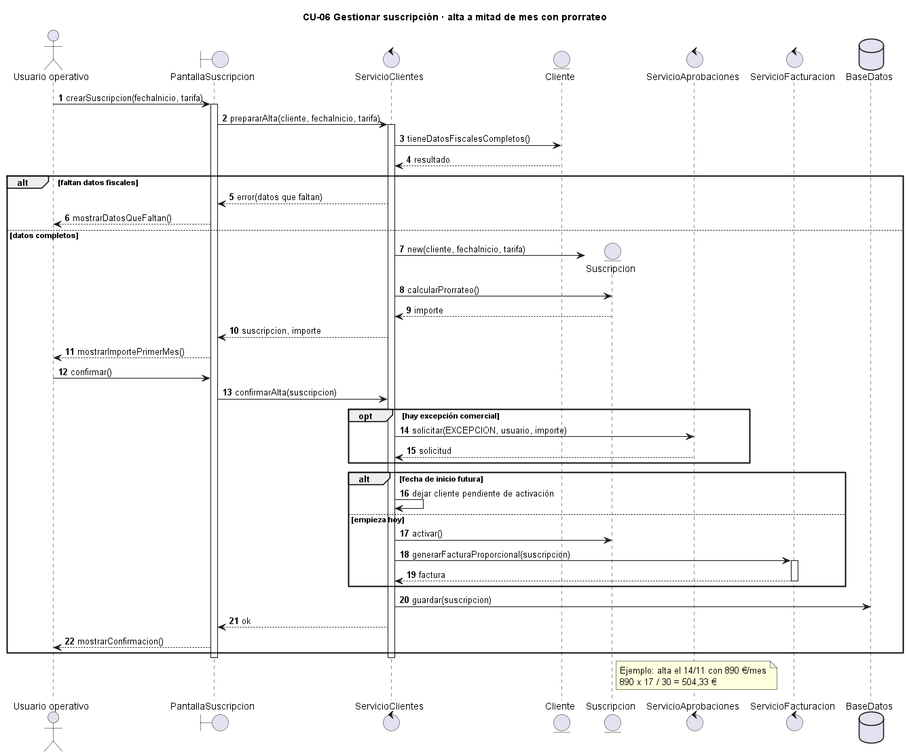
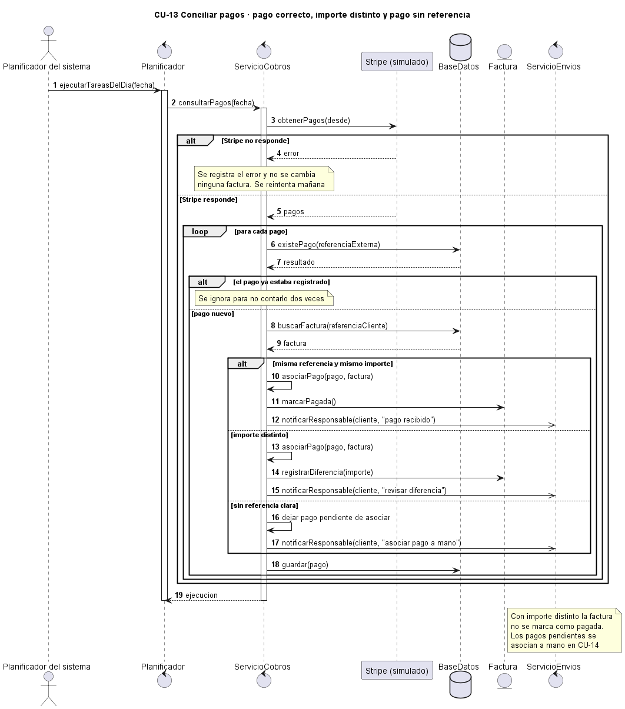
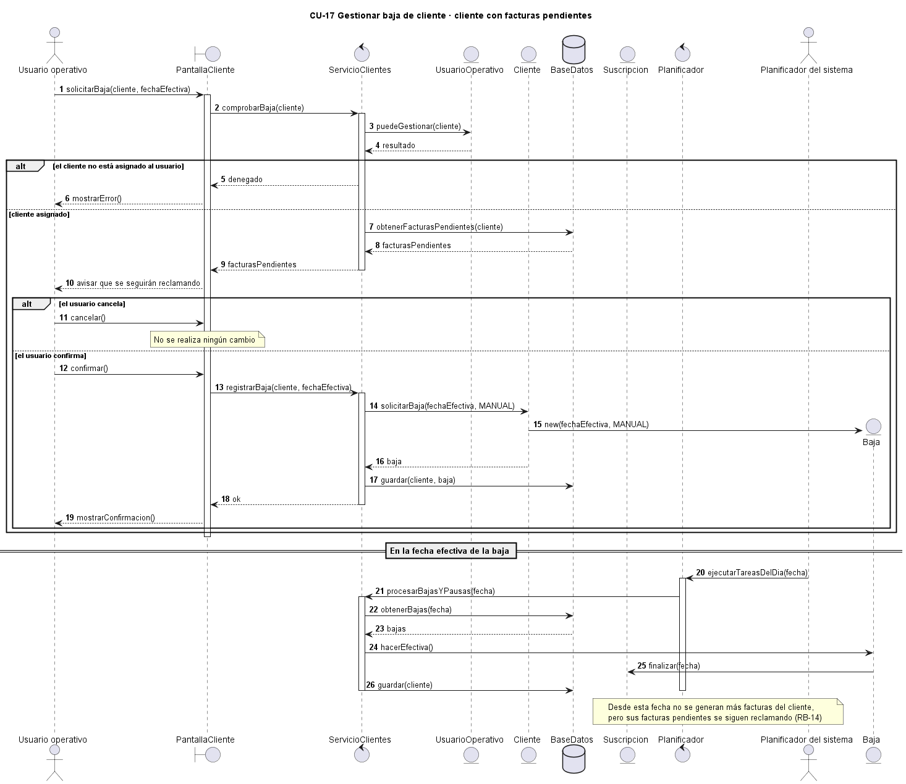

# Entrega 2 · Diseño del sistema

**Asignatura:** Análisis y Diseño de Aplicaciones · Grupo A · 2026–27  
**Equipo:** [Sapitos]  
**Integrantes:** [Francisco Jiménez Tirado][ Emilio José Aragón Ortegosa] [Marco Gallego Zafra][Ismael García Zamudio][Miguel Vargas Peña][Francisco Sánchez Gámez][Iván González Doña]
**Fecha:** [27/11/2026]  
**Repositorio:** [https://github.com/FrankiPato/ADA-sapitos.git]

## 1. Introducción y alcance

Ejemplo ficticio: «Este informe presenta el diseño de un sistema de gestión de pedidos a partir de RF-01 y CU-01». Sustituidlo por el alcance real de vuestro proyecto.

## 2. Actualizaciones de la Entrega 1

Estas modificaciones ya están aplicadas en `cambios_entrega1.md` y tienen como objetivo reforzar la trazabilidad, delimitar la automatización del sistema, corregir contradicciones internas y cubrir nuevas necesidades de gestión de cobros y bajas.

### Requisitos, reglas de negocio y supuestos modificados

* **FR-83 (Nuevo):** Permite pausar los recordatorios de pago con una fecha de reanudación cuando el cliente llama para negociar un aplazamiento.
  * *Motivo:* Petición directa del cliente tras una llamada comercial.
* **RB-22 (Nueva):** Establece que, mientras los recordatorios estén pausados, la factura sigue constando como pendiente y su fecha de vencimiento no varía.
  * *Motivo:* Aclarar la duda del cliente sobre cómo se reflejan estas pausas en el flujo de cobros.
* **RB-23 (Nueva):** Garantiza que el sistema no envíe dos veces el mismo mensaje aunque se repita el proceso de ejecución (implementado con una restricción `UNIQUE` en la tabla `ENVIO`).
  * *Motivo:* Responder a la pregunta del cliente sobre cómo evitar notificaciones duplicadas.
* **RB-14 (Modificada):** Deja explícito que la baja de un cliente no cancela ni condona sus deudas anteriores.
  * *Motivo:* El cliente solicitó que la regla lo indicara de forma expresa.
* **UR-19 y A-21 (Modificados):** Se incorpora UR-19 (sustituciones temporales) a las tablas de trazabilidad 8.1 y 8.2 y se elimina la «delegación temporal» de la asunción A-21.
  * *Motivo:* Resolver una contradicción interna, ya que A-21 la aplazaba mientras que UR-19 y FR-07 ya la incluían.
* **A-18, Glosario y apartado 1.3 (Modificados):** El «Planificador del sistema» pasa a definirse como un actor externo de tipo temporizador (paso del tiempo) y no como un componente interno.
  * *Motivo:* Indicación del profesor para separar actores externos, temporizadores y componentes internos (como la clase `Planificador`).

### Casos de uso modificados

* **CU-15 (Modificado):** Incorpora el nuevo flujo alternativo **FA-3 («Aplazamiento negociado por teléfono»)**, vinculado a la operación `registrarAplazamiento`.
  * *Motivo:* Recoger el nuevo requisito FR-83 dentro de los casos de uso.
* **CU-11 (Modificado):** Amplía el flujo alternativo **FA-2** para incluir también los aplazamientos y precisar que la suspensión dura «hasta que termine la pausa».
  * *Motivo:* Mantener la coherencia con FR-83 y RB-22.
* **CU-10, CU-11 y CU-15 (Trazabilidad):** Se añaden FR-83, RB-22 y RB-23 a sus respectivas secciones de requisitos relacionados.
  * *Motivo:* Asegurar la coherencia y completitud de la trazabilidad.

### Otros cambios estructurales y documentación

* **Nuevas tablas de trazabilidad y automatización:** A petición del profesor, se crean los apartados **8.3** y **8.4** (para enlazar reglas de negocio con requisitos funcionales y casos de uso, justificando así el diseño de clases, ER y secuencias) y el apartado **1.4** (tabla de procesos automáticos que delimita qué hace el sistema solo y cuándo interviene una persona). Como consecuencia, el antiguo apartado 8.3 pasa a ser el **8.5**.
* **Limpieza y estructura de carpetas:** Se elimina texto residual de plantilla en el apartado **1.2**, se reubican las fuentes de `doc/` a `entrega1-actualizada/fuentes/` y se responde a la duda del cliente sobre las facturas rectificativas mediante el diagrama `CU-12.puml`.

### Decisiones pendientes de confirmar con el cliente

Se mantienen seis hipótesis provisionales que no alteran el diseño actual, pero requieren validación:

* **Q-01:** Reclamar la deuda pendiente tras la baja del cliente (confirmado de forma implícita en su informe).
* **Q-17:** Cómputo del plazo de pago de 5 días en días naturales.
* **Q-10:** Rangos de tarifa configurables (pendiente recibir la tabla de tarifas actual).
* **Q-11 y Q-13:** Tiempo de conservación de datos y requisitos fiscales obligatorios de clientes extranjeros (a confirmar con la gestoría).
* **Q-12:** Campos exactos del PDF de la factura (pendiente recibir factura de ejemplo).
* **Q-14:** Umbrales de aprobación de 2.000 € y 10.000 €.

## 3. Modelo físico de datos (Entidad–Relación)

Insertad aquí el diagrama exportado de `diagramas/modelo_datos.puml` y la explicación de `documentacion/modelo_datos.md`. Incluid relaciones, PK/FK y decisiones relevantes.

## 4. Diagrama UML de clases

Insertad el diagrama exportado de `diagramas/diagrama_clases.puml` y la explicación de `documentacion/diagrama_clases.md`.

## 5. Diagramas UML de secuencia

### Selección de escenarios y trazabilidad con casos de uso

Se han elaborado cuatro diagramas de secuencia correspondientes a los casos de uso con mayor carga de reglas de negocio y que resuelven las principales dudas planteadas durante la elicitación de requisitos con el cliente:

| Diagrama    | Caso de uso (`casos_uso_Sapitos.pu`)                                                     | Escenario cubierto                                                                                                                                                        | Justificación y reglas aplicadas                                                                                                                                                                             |
| ----------- | ---------------------------------------------------------------------------------------- | ------------------------------------------------------------------------------------------------------------------------------------------------------------------------- | ------------------------------------------------------------------------------------------------------------------------------------------------------------------------------------------------------------ |
| `CU-06.png` | **CU-06: Gestionar suscripción (alta y pausa)** *(Diagrama 2: Clientes y suscripciones)* | **Alta a mitad de mes con prorrateo** (incluye alternativas de error por datos fiscales, excepción comercial con `<<extend>>` a `CU-21` y fecha de inicio futura vs. hoy) | Cubre el cálculo del prorrateo del primer mes (**RB-05**, **FR-17**), la validación de datos fiscales (**FR-20**) y la solicitud de aprobación ante excepciones comerciales (**FR-81**, **RB-13**).          |
| `CU-12.png` | **CU-12: Crear factura rectificativa** *(Diagrama 3: Facturación y envíos)*              | **Escenario principal de rectificación y flujo de aprobación** (incluye `<<include>>` a `CU-21` y la resolución de `CU-22` tanto aprobada como rechazada)                 | Muestra cómo se corrige una factura emitida sin alterarla (**RB-10**), pasando la original a estado `RECTIFICADA`, asignando numeración correlativa (**RB-11**) y vinculando ambas facturas (**FR-33**).     |
| `CU-13.png` | **CU-13: Conciliar pagos** *(Diagrama 4: Cobros y aprobaciones)*                         | **Proceso automático con tres escenarios de pago** (pago correcto, importe distinto y pago sin referencia clara, con `<<extend>>` a `CU-14` y caída de Stripe)            | Detalla la consulta periódica lanzada por el `Planificador`, el control de pagos duplicados, la conciliación automática (**RB-12**) y la derivación a revisión manual (**FR-45**, **FR-46**).                |
| `CU-17.png` | **CU-17: Gestionar baja de cliente** *(Diagrama 2: Clientes y suscripciones)*            | **Baja de un cliente con facturas pendientes** (incluye control de permisos, confirmación/cancelación y ejecución diferida en fecha efectiva)                             | Resuelve la gestión de bajas con deuda abierta (**Q-01**, **RB-14**): en la fecha efectiva el `Planificador` cierra la suscripción pero mantiene activos los recordatorios de cobro (**FR-53** a **FR-55**). |

**Notación utilizada:** Se emplea la notación estándar UML con estereotipos (`actor` para actores externos o temporizadores, `boundary` para pantallas de interfaz, `control` para servicios de negocio, `entity` para objetos del dominio y `database` para persistencia). Los mensajes están numerados secuencialmente, los retornos se representan con línea discontinua y los mensajes con flecha abierta indican comunicaciones asíncronas (envíos de facturas o notificaciones al responsable).

---

### 5.1. CU-06: Gestionar suscripción (alta a mitad de mes con prorrateo)

* **Caso de uso:** CU-06 — *Gestionar suscripción (alta y pausa)* (Diagrama 2: Clientes y suscripciones).
* **Escenario:** Alta de una nueva suscripción a mitad de mes con cálculo de prorrateo, contemplando validación previa de datos fiscales, posible excepción comercial (extensión con CU-21) y activación inmediata frente a fecha de inicio futura.

**Descripción del flujo:**

1. El usuario operativo introduce la fecha de inicio y la tarifa de la suscripción desde `PantallaSuscripcion`.
2. `ServicioClientes` comprueba que el cliente tiene todos los datos fiscales completos. Si falta alguno, devuelve el error indicando los campos ausentes y detiene el proceso (flujo de excepción **FE-1**).
3. Si los datos están completos, se instancia la entidad `Suscripcion` y se calcula el importe prorrateado del primer mes, mostrándolo al usuario antes de confirmar (**FR-17**, **RB-05**; por ejemplo, un alta el 14/11 con 890 €/mes equivale a $890 \times 17 / 30 = 504,33\text{ €}$).
4. Tras la confirmación del usuario, si existe una excepción comercial (`opt`), se invoca a `ServicioAprobaciones` para solicitar su validación (**FA-4**, **RB-13**).
5. Si la fecha de inicio es futura (`alt`), el cliente queda pendiente de activación (**FA-1**). Si empieza hoy, se activa la suscripción y `ServicioFacturacion` genera de forma asíncrona la factura proporcional correspondiente.
6. Finalmente, `ServicioClientes` persiste la suscripción en `BaseDatos` y muestra la confirmación al usuario.

---

### 5.2. CU-12: Crear factura rectificativa (escenario principal)

* **Caso de uso:** CU-12 — *Crear factura rectificativa* (Diagrama 3: Facturación y envíos), incluyendo CU-21 (*Solicitar aprobación*) y la posterior resolución mediante CU-22 (*Aprobar o rechazar solicitudes*).
* **Escenario:** Creación, solicitud de aprobación y emisión (o rechazo) de una factura rectificativa vinculada a una factura original ya emitida.

**Descripción del flujo:**

1. El usuario operativo solicita rectificar una factura emitida indicando el motivo desde `PantallaFacturas`.
2. `ServicioFacturacion` instancia `FacturaRectificativa`, calcula sus totales y registra una solicitud en `ServicioAprobaciones`, dado que toda factura rectificativa requiere aprobación obligatoria (**RB-13**). Se guarda en `BaseDatos` en estado *pendiente de aprobación* y se informa al usuario.
3. Posteriormente (en **CU-22**), el administrador revisa y resuelve la solicitud:
   * **Si es aprobada (`alt [aprobada]`):** `ServicioFacturacion` emite la rectificativa obteniendo el siguiente número correlativo de `Serie` (**RB-11**), marca la factura original como `RECTIFICADA` sin alterar sus datos (**RB-10**), genera el PDF de la rectificativa, persiste ambas en `BaseDatos` y delega su envío asíncrono a `ServicioEnvios`.
   * **Si es rechazada (`[rechazada]`):** la factura rectificativa no llega a emitirse y la factura original permanece intacta (**FE-1**).
4. En ambos desenlaces se notifica al administrador la confirmación o el rechazo procesado.

---

### 5.3. CU-13: Conciliar pagos (pago correcto, importe distinto y pago sin referencia)

* **Caso de uso:** CU-13 — *Conciliar pagos* (Diagrama 4: Cobros y aprobaciones), contemplando la extensión hacia CU-14 (*Asociar pago manualmente*) cuando no existe coincidencia exacta.
* **Escenario:** Ejecución diaria automatizada de conciliación de pagos contra Stripe (simulado), cubriendo indisponibilidad del servicio externo, idempotencia ante pagos duplicados y los tres casos posibles de conciliación.

**Descripción del flujo:**

1. El actor temporizador `Planificador del sistema` dispara la ejecución diaria sobre el componente `Planificador`, que invoca a `ServicioCobros` para consultar los pagos recibidos en `Stripe (simulado)`.
2. Si Stripe no responde (`alt [Stripe no responde]`), se registra el error sin modificar el estado de ninguna factura y se reintentará en la siguiente ejecución (**FE-2**).
3. Si Stripe responde, para cada pago recibido (`loop`) se verifica en `BaseDatos` si ya estaba registrado; si existe, se ignora para evitar duplicidades (**FE-1**).
4. Para cada pago nuevo, se busca la factura por referencia de cliente y se evalúan tres escenarios:
   * **Misma referencia y mismo importe:** se asocia el pago, la entidad `Factura` pasa a estado pagada y se notifica al responsable (`"pago recibido"`).
   * **Importe distinto:** se asocia el pago pero la factura no se marca como pagada; se registra la diferencia en `Factura` para su revisión manual en CU-14 (**FA-3**, **RB-12**) y se avisa al responsable (`"revisar diferencia"`).
   * **Sin referencia clara:** el pago queda pendiente de asociación manual en CU-14 (**FA-2**) y se avisa al responsable (`"asociar pago a mano"`).
5. Finalmente, se guarda el pago en `BaseDatos` y se devuelve el resultado de la ejecución al `Planificador`.

---

### 5.4. CU-17: Gestionar baja de cliente (cliente con facturas pendientes)

* **Caso de uso:** CU-17 — *Gestionar baja de cliente* (Diagrama 2: Clientes y suscripciones).
* **Escenario:** Solicitud manual de baja de un cliente que mantiene facturas pendientes de cobro, abarcando la verificación de asignación, advertencia de deuda, confirmación/cancelación y ejecución efectiva diferida mediante el planificador.

**Descripción del flujo:**

1. El usuario operativo solicita dar de baja a un cliente indicando una fecha efectiva desde `PantallaCliente`.
2. `ServicioClientes` verifica si el `UsuarioOperativo` tiene asignado dicho cliente; si no es así, deniega la operación y muestra un error (**FE-1**).
3. Si está asignado, consulta en `BaseDatos` las facturas pendientes y avisa al usuario de que estas se seguirán reclamando aunque se tramite la baja (**FA-1**, **RB-14**).
4. Si el usuario cancela (`alt [el usuario cancela]`), el flujo finaliza sin realizar cambios (**FA-2**).
5. Si confirma, `Cliente` crea una entidad `Baja` en estado de solicitud y `ServicioClientes` guarda los cambios en `BaseDatos`.
6. **En la fecha efectiva de la baja:** el `Planificador del sistema` activa al `Planificador`, que ordena a `ServicioClientes` procesar las bajas del día. Se recupera la baja, se marca como efectiva (`hacerEfectiva()`), se finaliza la `Suscripcion` y se actualiza el cliente en `BaseDatos`. A partir de esa fecha no se emiten nuevas facturas recurrentes, pero las facturas pendientes continúan su ciclo de cobro (**RB-14**, **Q-01**).

---

### Trazabilidad y consistencia de los diagramas de secuencia

| Diagrama    | Requisitos y reglas vinculados                    | Participantes / responsabilidades                                                                                                            |
| ----------- | ------------------------------------------------- | -------------------------------------------------------------------------------------------------------------------------------------------- |
| `CU-06.png` | CU-06 (FR-16 a FR-20, FR-81; RB-05, RB-13)        | `PantallaSuscripcion`, `ServicioClientes`, `Cliente`, `Suscripcion`, `ServicioAprobaciones`, `ServicioFacturacion`, `BaseDatos`              |
| `CU-12.png` | CU-12 y CU-22 (FR-33, FR-59; RB-10, RB-11, RB-13) | `PantallaFacturas`, `ServicioFacturacion`, `ServicioAprobaciones`, `Factura`, `FacturaRectificativa`, `Serie`, `ServicioEnvios`, `BaseDatos` |
| `CU-13.png` | CU-13 (FR-42 a FR-46, FR-62; RB-12)               | `Planificador`, `ServicioCobros`, `Stripe (simulado)`, `Factura`, `ServicioEnvios`, `BaseDatos`                                              |
| `CU-17.png` | CU-17 (FR-53 a FR-55; RB-14, RB-19)               | `PantallaCliente`, `ServicioClientes`, `UsuarioOperativo`, `Cliente`, `Baja`, `Suscripcion`, `Planificador`, `BaseDatos`                     |

* **Consistencia con el diagrama de clases:** Los servicios (`control`) y las entidades del dominio (`entity`) coinciden con las clases definidas en el modelo estructural, y los mensajes reflejan sus métodos (`prepararAlta`, `calcularProrrateo`, `crearRectificativa`, `marcarRectificada`, `registrarDiferencia`, `hacerEfectiva`).
* **Nivel de abstracción:** Las clases frontera (`PantallaSuscripcion`, `PantallaFacturas`, `PantallaCliente`) y `BaseDatos` no se modelan en el diagrama de clases de dominio porque pertenecen a las capas de presentación y persistencia reflejadas en la arquitectura.
* **Consistencia con casos de uso y modelo físico:** El actor `Planificador del sistema` representa el disparador temporal externo que activa el componente interno `Planificador`, mientras que las operaciones sobre `BaseDatos` corresponden directamente con las tablas físicas `SUSCRIPCION`, `FACTURA`, `PAGO`, `CONCILIACION`, `CLIENTE` y `BAJA`.

---

## 6. Arquitectura y componentes

### Vista representada

El diagrama representa la **arquitectura lógica en capas** del sistema sobre un modelo cliente-servidor (los usuarios acceden mediante navegador web y toda la lógica reside en el servidor). Se estructura en cuatro niveles jerárquicos donde cada capa únicamente depende de las inferiores:

1. **Capa de presentación:** Compuesta por la interfaz web responsive para el personal interno de Turbine y la API REST destinada a sistemas externos.
2. **Capa de negocio:** Contiene el componente `Planificador` y los servicios que encapsulan las reglas de negocio (`ServicioClientes`, `ServicioFacturacion`, `ServicioCobros`, `ServicioAprobaciones` y `ServicioEnvios`), correspondientes a las clases de control del diagrama de clases.
3. **Capa de integración:** Agrupa los adaptadores que aíslan la comunicación con servicios externos simulados (`Adaptador de mensajería` y `Adaptador de pagos`).
4. **Capa de persistencia:** Formada por los `Repositorios` que gestionan el acceso a la base de datos relacional y al almacén de archivos PDF de las facturas.

---

### Responsabilidades de los componentes

| Componente                    | Capa         | Responsabilidad                                                                                                                                                                                            | Relaciones principales                                      |
| ----------------------------- | ------------ | ---------------------------------------------------------------------------------------------------------------------------------------------------------------------------------------------------------- | ----------------------------------------------------------- |
| **Interfaz web (responsive)** | Presentación | Proporciona las pantallas de trabajo para los usuarios internos, adaptándose a ordenador, tablet y móvil.                                                                                                  | Capa de negocio                                             |
| **API REST**                  | Presentación | Punto de entrada para otros sistemas de Turbine (consultas de deuda y solicitudes de baja) con autenticación por token vía HTTPS.                                                                          | `ServicioFacturacion`, `ServicioClientes`                   |
| **Planificador**              | Negocio      | Componente interno que recibe la señal temporal del actor *Planificador del sistema* y lanza las tareas programadas del día (facturación del día 1, conciliación de pagos, recordatorios, bajas y pausas). | `ServicioFacturacion`, `ServicioCobros`, `ServicioClientes` |
| **ServicioClientes**          | Negocio      | Gestiona el ciclo de vida de clientes, contactos, importación CSV, suscripciones, pausas, bajas y revisiones anuales.                                                                                      | `ServicioAprobaciones`, `Repositorios`                      |
| **ServicioFacturacion**       | Negocio      | Gestiona la creación, cálculo, emisión, numeración, rectificación y generación de PDF de facturas puntuales, recurrentes y proporcionales.                                                                 | `ServicioAprobaciones`, `ServicioEnvios`, `Repositorios`    |
| **ServicioCobros**            | Negocio      | Coordina la consulta y conciliación de pagos, gestión de disputas, incidencias, aplazamientos y declaración de incobrables.                                                                                | `Adaptador de pagos`, `ServicioEnvios`, `Repositorios`      |
| **ServicioAprobaciones**      | Negocio      | Controla el flujo de solicitudes de aprobación para operaciones económicas sensibles y la separación de funciones.                                                                                         | `Repositorios`                                              |
| **ServicioEnvios**            | Negocio      | Gestiona el envío de facturas y recordatorios a clientes, así como las notificaciones internas a los responsables.                                                                                         | `Adaptador de mensajería`                                   |
| **Adaptador de pagos**        | Integración  | Encapsula la comunicación con la pasarela `Stripe (simulado)` para obtener los pagos recibidos.                                                                                                            | `Stripe (simulado)`                                         |
| **Adaptador de mensajería**   | Integración  | Encapsula el envío de mensajes por email y WhatsApp y recoge el estado de entrega.                                                                                                                         | `Servicio de mensajería (simulado)`                         |
| **Repositorios**              | Persistencia | Abstraen el acceso a datos para almacenar y consultar entidades en la base de datos y ficheros en el almacén de PDF.                                                                                       | `Base de datos`, `Almacén de PDF`                           |

---

### Justificación arquitectónica, restricciones y alternativas

* **Elección de arquitectura en capas:** Al tratarse de una aplicación interna desarrollada por un equipo reducido con operaciones financieras críticas, la separación entre presentación, lógica de negocio, integración y persistencia facilita la comprensión, el mantenimiento y las pruebas unitarias (**NFR-26**, **NFR-27**), permitiendo modificar una capa sin impactar en las demás.
* **Desacoplamiento entre temporizador y componente interno:** Se diferencia claramente el actor externo *Planificador del sistema* (que modela el paso del tiempo en los casos de uso) del componente interno `Planificador` (que recibe la señal y orquesta los servicios), cumpliendo con la decisión de diseño **A-18**.
* **Uso de adaptadores para servicios externos:** Aislar Stripe y los canales de mensajería tras adaptadores permite sustituir las versiones simuladas por los servicios reales o incorporar nuevas pasarelas de pago en el futuro sin alterar la lógica de negocio (**NFR-24**).
* **Consistencia de reglas en la API:** La API REST reutiliza exactamente los mismos servicios de la capa de negocio que la interfaz web, asegurando que se aplican idénticas reglas de negocio y controles de permisos (**FR-78**).
* **Restricciones arquitectónicas:**
  * La capa de presentación nunca accede directamente a la capa de persistencia ni a la base de datos.
  * Los procesos batch o pesados (como la facturación masiva mensual o la exportación de informes extensos) se ejecutan en segundo plano para evitar bloqueos en la interfaz (**NFR-09**).
  * Toda la pila tecnológica empleada se basa en software libre (**NFR-28**).
* **Alternativas descartadas:**
  * *Arquitectura de microservicios:* Descartada por introducir una complejidad operativa y de despliegue innecesaria para el tamaño del equipo y el alcance interno del sistema.
  * *Arquitectura orientada a eventos:* Descartada porque las tareas automáticas están regidas por hitos de calendario y fechas programadas, resolviéndose de forma más simple y determinista mediante un planificador centralizado.

---

### Trazabilidad con casos de uso y resto de vistas

| Grupo de casos de uso                                                                   | Componentes arquitectónicos involucrados                                                        |
| --------------------------------------------------------------------------------------- | ----------------------------------------------------------------------------------------------- |
| **CU-01, CU-02, CU-03** (Acceso y gestión de usuarios)                                  | `Interfaz web`, `Repositorios`                                                                  |
| **CU-04, CU-05, CU-06, CU-17, CU-20** (Clientes y suscripciones)                        | `Interfaz web`, `ServicioClientes`, `ServicioAprobaciones`, `Repositorios`                      |
| **CU-07, CU-08, CU-12, CU-16** (Facturación y rectificativas)                           | `Interfaz web`, `ServicioFacturacion`, `ServicioAprobaciones`, `ServicioEnvios`, `Repositorios` |
| **CU-09** (Generación de facturas recurrentes)                                          | `Planificador`, `ServicioFacturacion`, `ServicioEnvios`, `Repositorios`                         |
| **CU-10, CU-11** (Envío de facturas y recordatorios)                                    | `ServicioEnvios`, `ServicioCobros`, `Adaptador de mensajería`                                   |
| **CU-13, CU-14, CU-15** (Cobros, conciliación e incidencias)                            | `Planificador`, `ServicioCobros`, `Adaptador de pagos`, `Repositorios`                          |
| **CU-18, CU-19** (Integración externa vía API)                                          | `API REST`, `ServicioClientes`, `ServicioFacturacion`, `Repositorios`                           |
| **CU-21, CU-22** (Flujo de aprobaciones)                                                | `Interfaz web`, `ServicioAprobaciones`, `Repositorios`                                          |
| **CU-23 a CU-27** (Pantalla de trabajo, búsquedas, informes, configuración y auditoría) | `Interfaz web`, `Repositorios`                                                                  |

**Correspondencia entre vistas del diseño:**

* Los componentes de la **capa de negocio** se corresponden directamente con las clases de control del **diagrama UML de clases**.
* Las pantallas representadas en los **diagramas de secuencia** se integran dentro de la `Interfaz web` de la capa de presentación.
* El elemento `BaseDatos` de los diagramas de secuencia engloba a los `Repositorios` y a la `Base de datos` relacional descrita en el **modelo físico de datos**.

## 7. Informe Scrum

Incorporad el contenido cumplimentado de `informe_scrum.md`, junto con las capturas reales del tablero y las evidencias exigidas.

## 8. Conclusiones y referencias (si proceden)

En este proyecto hemos diseñado la arquitectura completa para un sistema de gestión de clientes, suscripciones y facturación periódica. A lo largo del trabajo, combinando los diagramas de clases (vistas de negocio, facturación y servicios de control) con el modelo relacional físico, hemos buscado dar respuesta a los requerimientos que plantea un modelo de negocio basado en ingresos recurrentes.

El diseño del sistema se articula en tres bloques principales:

1. **Gestión de usuarios y clientes:** Define la estructura de permisos mediante roles (`UsuarioOperativo`, `Administrador`, `Superadministrador`) y contempla el ciclo de vida completo del cliente y sus suscripciones (incluyendo casos reales como pausas temporales, altas, bajas, prorrateos y excepciones en las tarifas).

2. **Facturación, cobros y notificaciones:** Garantiza la correcta emisión de comprobantes (diferenciando facturas normales, proporcionales y rectificativas), la conciliación de los pagos recibidos y la gestión de incidencias, integrando además el envío de recordatorios automáticos por Email o WhatsApp.

3. **Servicios de control y base de datos:** Incorpora una capa de servicios desacoplada y un `Planificador` de tareas programadas que automatiza los procesos diarios. Todo esto se apoya en un modelo físico relacional normalizado que asegura la consistencia de los datos.

### Aspectos Clave y Decisiones de Diseño

Del desarrollo de este trabajo y del análisis de los diagramas se desprenden varias conclusiones técnicas importantes:

* **Control financiero y trazabilidad:** Para evitar inconsistencias o problemas contables, las facturas emitidas no se modifican directamente, sino que los errores o ajustes se corrigen mediante facturas rectificativas o incidencias. Además, la inclusión de la clase `RegistroAuditoria` y de reglas como la aprobación cruzada (que impide que un usuario apruebe sus propias solicitudes si superan cierto importe) aporta seguridad al sistema.

* **Reducción de carga manual mediante automatización:** Al delegar la lógica repetitiva a servicios específicos (`ServicioFacturacion`, `ServicioCobros`, `ServicioEnvios`) y al `Planificador`, se consigue que el sistema genere facturas periódicas y envíe notificaciones sin necesidad de intervención manual constante, reduciendo el riesgo de errores humanos.

* **Flexibilidad sin perder rigor en los datos:** El diseño contempla situaciones complejas habituales en la gestión comercial B2B (descuentos, cambios tarifarios o suspensiones de servicio) manteniendo la precisión numérica (`DECIMAL`) y las restricciones necesarias a nivel de base de datos para evitar pérdidas de información.

### Valoración Final

El trabajo realizado demuestra que la solución planteada no solo cumple con los requisitos funcionales iniciales, sino que además está estructurada siguiendo buenas prácticas de ingeniería del software. La correspondencia directa entre los diagramas UML de clases, el modelo relacional físico, el diagrama de arquitectura y componentes principales y el modelo secuencial de alguno de los casos de uso mas relevantes, garantiza que la propuesta sea coherente, robusta y esté lista para ser llevada a una fase de desarrollo e implementación real.
