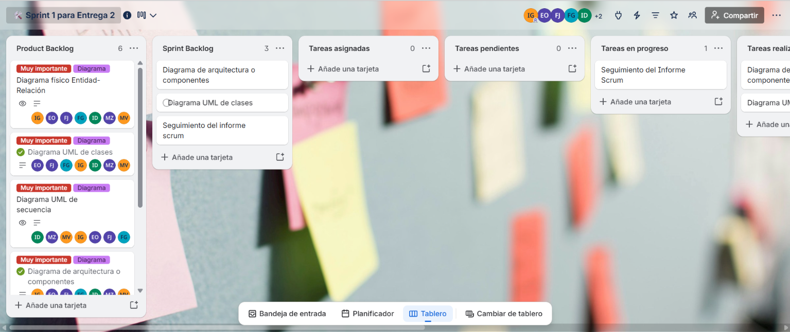
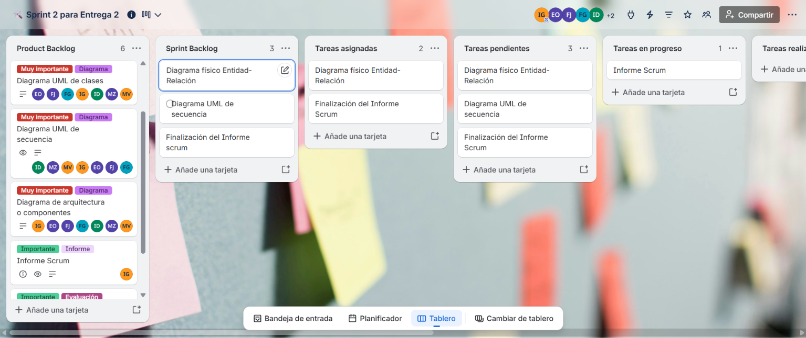
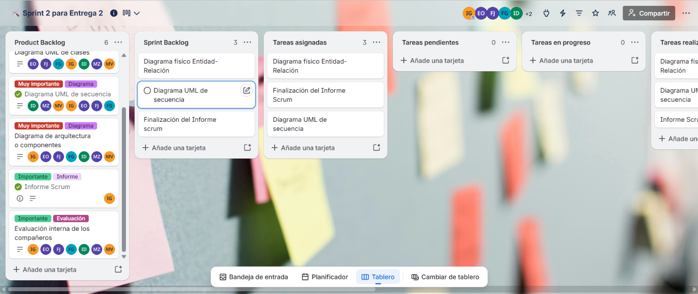

# Informe Scrum · Entrega 2

## Identificación del equipo

| Nombre y apellidos | Rol | 
|---|---| 
| Ismael García Zamudio | Scrum Master | 
| Emilio José Aragón Ortigosa | Miembro | 
| Marco Gallego Zafra | Miembro | 
| Iván González Doña | Miembro | 
| Francisco Jiménez Tirado | Miembro | 
| Francisco Sánchez Gámez | Miembro |
| Miguel Vargas Peña | Miembro |

## Reuniones del periodo

| Fecha | Inicio | Duración | Participantes | Temas y acuerdos |
|---|---|---|---|---|
| 29/10/2026 | 8:45 | 1h 45min | Todos | Planificación, reparto de tareas y orden de tareas a realizar |
| 5/11/2026 | 8:45 | 1h 45min | Todos | Seguimiento de los diagramas UML de clases y diagrama de arquitectura o componentes. Puesta en común sobre añadir o quitar cosas de los diagramas |
| 6/11/2026 | 17:00 | 1h 30min | Todos | Continuamos con el seguimiento de los diagramas y puesta en común |
| 13/11/2026 | 16:00 | 2h | Todos | Finalización de los diagramas UML de clases y diagrama de arquitectura o componentes. También comentamos las tareas del siguiente sprint y el orden de realización |
| 19/11/2026 | 17:30 | 1h 30min | Todos | Planificación de los diagramas que quedan por hacer, reparto de tareas y orden a realizar |
| 26/11/2026 | 8:45 | 1h 45min | Todos | Finalización de los últimos detalles de los diagramas. Finalización de los informes disponibles para la entrega |
| 27/11/2026 | 16:30 | 2h | Todos | Dejamos todo preparado para la entrega 2, mejoramos calidad de imágenes de los diagramas y finalización del informe Scrum y revisión final de todos los diagramas |

## Estado del product backlog y Sprint backlog

**Tablero:** https://trello.com/b/zpkoY104/%F0%9F%9B%A0%EF%B8%8F-sprint-2-para-entrega-2

 (evidencias/Sprint1 planning2.png) 
 (evidencias/Sprint1 retrospective2.png)
 (evidencias/Sprint2 planning2.png)
 (evidencias/Sprint2 retrospective2.png)

## Información de tareas

| Tarea | Responsable | Milestone | Prioridad | Etiqueta | Descripción / estado |
|---|---|---|---|---|---|
| Diagrama UML de clases | Todos | Entrega 2 | Muy alta | Diagrama | Definir y completar el diagrama UML de clases |
| Diagrama de arquitectura o componentes | Todos | Entrega 2 | Muy alta | Diagrama | Definir y completar el diagrama de arquitectura o componentes |
| Seguimiento del informe Scrum y realización de tableros en Trello |Todos | Entrega 2 | Alta | Informe | Realizar tableros del sprint planning y sprint retrospective e ir completando el informe scrum con los datos y tareas ya realizadas |
| Diagrama físico Entidad-Relación | Todos | Entrega 2 | Muy alta | Diagrama | A partir del diagrama UML de clases anteriormente ya realizado, construir el diagrama físico Entidad-Relación |
| Diagrama UML de secuencia | Todos | Entrega 2 | Muy alta | Diagrama | Definir y completar el diagrama UML de secuencia |
| Finalización del informe Scrum | Todos | Entrega 2 | Alta | Informe | Completar el informe Scrum |
| Mejora de calidad en imágenes de los diagramas | Todos | Mejora de la entrega 1 | Media | Mejora | Con respecto a la entrega 1, hemos mejorado la calidad visual de las imágenes de los diagramas |

## Problemas y riesgos

| Sprint | Problema/riesgo | Impacto | Medida aplicada | Estado |
|---|---|---|---|---|
| Sprint 1 | Confusión sobre por cual diagrama empezar a trabajar | Al principio empezamos por el diagrama físico Entidad-Relación y eso nos hizo perder un poco de tiempo | El profesor nos aconsejó que lo conveniente era empezar por el diagrama UML de clases y el diagrama de arquitectura | Realizado |
| Sprint 1 | Dificultad para realizar todo en un solo diagrama UML de clases | Confusión sobre cómo poder arreglarlo | Realizar varias vistas del diagrama UML de clases para mejorar la calidad y la visualización de este y que no quede un diagrama tan grande | Finalizado |
| Sprint 2 | Dificultad para realizar el diagrama de secuencia | Al no saber muy bien como era ni cuantos diagramas habría que hacer, nos ha llevado más tiempo para ponernos de acuerdo y realizarlo | Hemos realizado 4 diagramas de secuencia que hemos considerado más importantes | Realizado |

## Revisión y retrospectiva

- **Logros:**
    - Mejora visual de las imágenes de los diagramas
    - Mejor organización de trabajo que en la entrega 1
    - Definición de la estructura del sistema
    - Identificación de las entidades y relaciones
    - Diseño de la arquitectura del sistema
    - Representación de los procesos del sistema
    - Mayor comprensión del proyecto

- **Aspectos positivos:** 
    - Dividir diagrama de clases UML para una mejor visualización
    - Buena comunicación y colaboración entre los integrantes del equipo
    - Reparto adecuado de las tareas, permitiendo trabajar de forma organizada
    - Cumplimiento de objetivos en el plazo establecido
    - Aprendizaje de nuevas herramientas
    - Mejor resolución a los problemas enfrentados

- **Mejoras:**
    - Reparto adecuado de las tareas, permitiendo trabajar de forma organizada
    - Mantener una comunicación más frecuente entre los integrantes del equipo
    - Realizar revisiones conjuntas para comprobar que los diagramas sean correctos y coherentes entre sí
    - Resolver las dudas técnicas con mayor antelación para evitar posibles retrasos

- **Acciones siguientes:** 
    - Evaluación de los grupos de poster y de los compañeros
    - Preparar las presentaciones para la sesión de poster
    - Preparar las preguntas para otros grupos en la sesión de poster
    - Preparar y organizar la entrega 3
    - Corregir errores que pueden aparecer en la entrega 2

